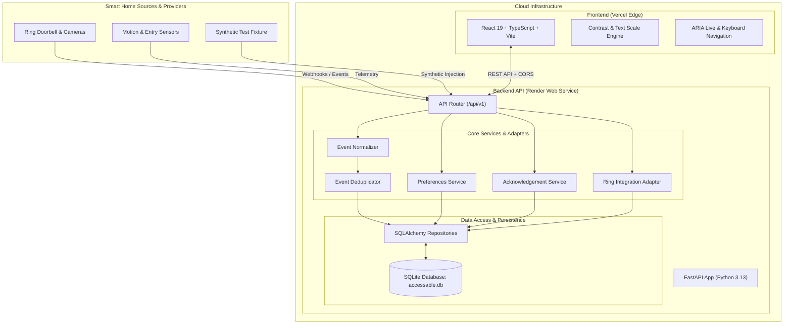

# AccessAble

> **Every alert, accessible to all.**  
> An inclusive smart home event history and multi-sensory alert acknowledgement hub designed for deaf, hard-of-hearing, and visually impaired individuals.

[](https://access-able-ruddy.vercel.app)
[](https://accessable-backend-hfl4.onrender.com/docs)
[](https://www.w3.org/WAI/standards-guidelines/wcag/)
[](https://github.com/nishasss692/AccessAble)
[](LICENSE)

---

## Table of Contents

- [Overview](#overview)
- [Live Deployments](#live-deployments)
- [Key Features](#key-features)
- [System Architecture](#system-architecture)
- [Technology Stack](#technology-stack)
- [Project Directory Structure](#project-directory-structure)
- [Local Development Setup](#local-development-setup)
  - [Prerequisites](#prerequisites)
  - [Backend Setup](#backend-setup)
  - [Frontend Setup](#frontend-setup)
- [Environment Configuration](#environment-configuration)
- [REST API Reference](#rest-api-reference)
- [Running Automated Tests](#running-automated-tests)
- [Accessibility (WCAG 2.1 AA) Compliance](#accessibility-wcag-21-aa-compliance)
- [Roadmap](#roadmap)
- [License](#license)

---

## Overview

Over 1.5 billion people worldwide live with hearing loss, and hundreds of millions live with visual or sensory impairments. Traditional smart home devices rely almost exclusively on high-frequency chimes or fleeting, low-contrast push notifications that are easily missed.

**AccessAble** transforms smart home awareness into an accessible, multi-sensory experience. It aggregates events from smart home ecosystems (such as Ring doorbells, motion sensors, and smart locks) and delivers high-contrast visual cues, screen pulses, audio tones, and customizable text scaling. With a single tap or keyboard shortcut, users can acknowledge alerts, logging a real-time audit trail.

---

## Live Deployments

| Component | Platform | URL |
| :--- | :--- | :--- |
| **Frontend Web App** | Vercel | [https://access-able-ruddy.vercel.app](https://access-able-ruddy.vercel.app) |
| **Backend REST API** | Render | [https://accessable-backend-hfl4.onrender.com](https://accessable-backend-hfl4.onrender.com) |
| **Interactive API Docs** | Render Swagger UI | [https://accessable-backend-hfl4.onrender.com/docs](https://accessable-backend-hfl4.onrender.com/docs) |
| **Service Health Check** | Render API | [https://accessable-backend-hfl4.onrender.com/api/v1/health](https://accessable-backend-hfl4.onrender.com/api/v1/health) |

---

## Key Features

- **Multi-Sensory Alerting**: Converts incoming events into high-visibility screen flashes, high-contrast badges, and audible frequency alerts.
- **Accessible Event History**: A chronological event feed with severity indicators (doorbell chime, motion detection, camera activity, system status), source filtering, and instant search.
- **One-Touch Acknowledgement**: Users can verify and acknowledge alerts with a single click or keyboard shortcut (`Enter`/`Space`), tracking response timestamps and notes.
- **Dynamic Accessibility Preferences**: Instant switching between standard and high-contrast modes, dynamic text scaling (Small, Normal, Large, Extra Large), and alert toggle controls that persist in the database.
- **Smart Home Integration & Health Telemetry**: Live connection status, last sync timestamp, and error reporting for connected providers like Ring.
- **Full WCAG 2.1 AA Compliance**: Built with ARIA live regions, semantic HTML5 landmarks, visible high-contrast focus rings, and complete keyboard navigation.

---

## System Architecture



---

## Technology Stack

### Frontend
- **Framework**: React 19, TypeScript
- **Build Tool**: Vite
- **Styling**: Tailwind CSS & CSS Custom Properties for dynamic theming
- **Icons**: Lucide React
- **Hosting**: Vercel

### Backend & Database
- **Framework**: FastAPI (Python 3.13)
- **ASGI Server**: Uvicorn
- **ORM**: SQLAlchemy 2.0
- **Database**: SQLite (idempotent auto-migration via FastAPI lifespan)
- **Validation**: Pydantic v2
- **Hosting**: Render

### DevOps & Quality Assurance
- **Automated Testing**: Pytest, AnyIO (104 passing tests)
- **Keep-Alive Automation**: GitHub Actions workflow (prevents free-tier cold starts)
- **Version Control**: Git & GitHub

---

## Project Directory Structure

```text
AccessAble/
├── .github/
│   └── workflows/
│       └── keep-alive.yml          # GitHub Actions keep-alive workflow
├── backend/
│   ├── app/
│   │   ├── api/                    # API route definitions
│   │   │   ├── router.py           # Combined API router
│   │   │   └── v1/                 # Endpoints: events, acknowledgements, preferences, integrations
│   │   ├── db/
│   │   │   ├── base.py             # Canonical Base & model imports
│   │   │   └── init_db.py          # Table initialization logic
│   │   ├── integrations/           # Provider integrations (Ring adapter & status)
│   │   ├── models/                 # SQLAlchemy ORM models
│   │   ├── repositories/           # Database access layer
│   │   ├── schemas/                # Pydantic schemas (Deduplication, Event, Preferences)
│   │   ├── services/               # Normalization, deduplication, preferences logic
│   │   ├── tests/                  # 94 backend automated test suite
│   │   ├── config.py               # Pydantic BaseSettings
│   │   ├── database.py             # Engine & SessionLocal setup
│   │   └── main.py                 # FastAPI app entry with lifespan handler
│   ├── init_db.py                  # Standalone database initialization script
│   ├── pyproject.toml              # Pytest configuration
│   └── requirements.txt            # Python dependencies
├── frontend/
│   ├── src/
│   │   ├── components/             # Accessible UI components (Navbar, EventFeed, Preferences, etc.)
│   │   ├── context/                # Theme and Accessibility State Context
│   │   ├── services/               # Axios / Fetch API client
│   │   ├── types/                  # TypeScript interface definitions
│   │   ├── App.tsx                 # Main application view
│   │   └── index.css               # Accessibility themes & high-contrast variables
│   ├── package.json
│   ├── tsconfig.json
│   └── vite.config.ts
├── docs/                           # Architectural guides & API contracts
├── render.yaml                     # Render deployment blueprint
└── README.md                       # Master documentation
```

---

## Local Development Setup

### Prerequisites
- **Python 3.11+** (Python 3.13 recommended)
- **Node.js 18+** and **npm**
- **Git**

### Backend Setup

1. **Navigate to the backend directory**:
   ```bash
   cd backend
   ```

2. **Create and activate a virtual environment**:
   - **Windows (PowerShell)**:
     ```powershell
     python -m venv .venv
     .\.venv\Scripts\Activate.ps1
     ```
   - **macOS / Linux**:
     ```bash
     python3 -m venv .venv
     source .venv/bin/activate
     ```

3. **Install dependencies**:
   ```bash
   pip install -r requirements.txt
   ```

4. **Initialize the SQLite database**:
   ```bash
   python init_db.py
   ```
   *(Registers all tables: `events`, `acknowledgements`, `source_connections`, `user_preferences`).*

5. **Start the FastAPI backend server**:
   ```bash
   python -m uvicorn app.main:app --reload --port 8000
   ```
   The backend will be live at `http://localhost:8000`.  
   Interactive Swagger docs: `http://localhost:8000/docs`.

---

### Frontend Setup

1. **Open a new terminal and navigate to the frontend directory**:
   ```bash
   cd frontend
   ```

2. **Install npm dependencies**:
   ```bash
   npm install
   ```

3. **Verify or create `.env` in the `frontend/` folder**:
   ```env
   VITE_API_BASE_URL=http://localhost:8000
   ```

4. **Start the Vite development server**:
   ```bash
   npm run dev
   ```
   The frontend will be live at `http://localhost:5173`.

---

## Environment Configuration

### Backend (`backend/.env` or Render Environment Variables)
| Variable | Default Value | Description |
| :--- | :--- | :--- |
| `APP_NAME` | `AccessAble API` | Name of the application |
| `API_PREFIX` | `/api/v1` | Global prefix for all API routes |
| `DATABASE_URL` | `sqlite:///./accessable.db` | SQLAlchemy connection string |
| `CORS_ORIGINS` | `http://localhost:5173` | Comma-separated allowed CORS origins |

### Frontend (`frontend/.env` or Vercel Environment Variables)
| Variable | Example Value | Description |
| :--- | :--- | :--- |
| `VITE_API_BASE_URL` | `https://accessable-backend-hfl4.onrender.com` | Base URL pointing to the FastAPI backend |

---

## REST API Reference

All routes are prefixed with `/api/v1`.

| Method | Endpoint | Description |
| :--- | :--- | :--- |
| `GET` | `/health` | Service health status and database connectivity |
| `GET` | `/events` | Paginated and filtered event history (`?source=&limit=&offset=`) |
| `POST` | `/events` | Ingest a new event with automatic deduplication |
| `GET` | `/events/{event_id}` | Retrieve details for a single event |
| `GET` | `/acknowledgements` | Retrieve acknowledgement logs (`?event_id=`) |
| `POST` | `/acknowledgements` | Acknowledge an event with an optional note |
| `GET` | `/preferences` | Retrieve user accessibility preferences |
| `PUT` | `/preferences` | Update contrast, audio/visual alerts, and text scaling |
| `GET` | `/integrations/ring/status` | Retrieve connection health and sync telemetry for Ring |
| `POST` | `/integrations/ring/webhook` | Ingest live or simulated Ring doorbell/motion webhooks |

---

## Running Automated Tests

AccessAble includes a comprehensive test suite of **104 automated tests** verifying event ingestion, deduplication, normalizers, accessibility preference persistence, and end-to-end integration workflows.

To run all backend tests:
```bash
cd backend
pytest
```

Output:
```text
======================== 94 passed, 1 warning in 6.92s ========================
```

To run Ring integration tests:
```bash
pytest -o pythonpath=. integrations/ring/tests/test_adapter.py integrations/ring/tests/test_webhook_receiver.py
```

*All tests run against isolated in-memory databases and do not modify production or local SQLite database files.*

---

## Accessibility (WCAG 2.1 AA) Compliance

AccessAble was engineered following **Web Content Accessibility Guidelines (WCAG) 2.1 Level AA**:

- **Color Contrast**: Standard and High Contrast modes maintain a minimum 7:1 contrast ratio for normal text and 4.5:1 for UI components.
- **Dynamic Text Scaling**: Supports scaling up to 200% without horizontal scrolling, overlapping text, or clipping interactive buttons.
- **Non-Text Audio/Visual Cues**: Information conveyed via sound (doorbell chimes) is simultaneously accompanied by distinct visual screen pulses and badges.
- **Keyboard Navigation**: All interactive elements (filters, acknowledgement buttons, preferences) are fully accessible using `Tab`, `Shift+Tab`, `Enter`, and `Space`, featuring distinct focus rings (`:focus-visible`).
- **Screen Reader Support**: Complete ARIA attributes (`aria-live="polite"`, `role="status"`, `aria-label`) ensure seamless announcement of newly arriving events.

---

## Roadmap

- [ ] **Smart Lighting Support**: Webhook triggers for Philips Hue & LIFX bulbs for whole-home ambient visual alerts.
- [ ] **Wearable Haptic Integration**: Vibrational alerts for Apple Watch and WearOS devices.
- [ ] **Google Nest & Matter Integration**: Expansion of the provider adapter layer to support Matter/Thread smart devices.
- [ ] **AI-Powered Visual Descriptions**: Computer vision integration to summarize camera frames into concise text (e.g., *"Package delivered on porch"*).

---

## License

This project is licensed under the **MIT License** — see the [LICENSE](LICENSE) file for details.