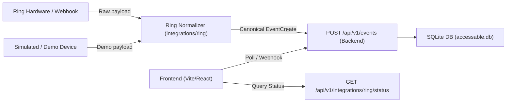

# Ring Integration Guide & Specification

This guide documents the Ring device integration architecture, connection states, data normalization, and verification steps for AccessAble.

---

## 1. Overview & Architecture

AccessAble ingests doorbell rings, motion alerts, and camera events to provide accessible multimodal alerts (visual flashing, audio cues, high contrast).

The integration architecture separates event ingestion into two tiers:
1. **Integration Tier (`integrations/ring/`)**: Probes Ring hardware/APIs and normalizes raw payloads into the canonical schema.
2. **Backend Core (`backend/app/`)**: Provides persistent event storage, duplicate prevention, acknowledgement tracking, user preferences, and client APIs.



---

## 2. Integration Connection States

The backend exposes `GET /api/v1/integrations/ring/status` to reflect verified hardware connectivity:

| State | `is_connected` | Meaning |
|---|---|---|
| `unknown` | `false` | Default baseline. Live Ring credentials/tokens are unconfigured. Demo events are fully functional. |
| `connected` | `true` | Valid session established and upstream stream/polling is verified active. |
| `disconnected` | `false` | Ring service is intentionally paused or network connection was dropped. |
| `error` | `false` | Upstream authentication or connection failure (non-sensitive error returned in `error_message`). |

*Note: The backend never reports `connected` merely because FastAPI is running. True connectivity requires active verification.*

---

## 3. Demo vs. Real Events

To ensure reliable frontend testing and demonstrations during hackathons without needing physical Ring hardware:

| Attribute | Demo Events | Real Ring Events |
|---|---|---|
| `source` | `"demo"` | `"ring"` |
| `external_event_id` | Optional / e.g. `"demo-001"` | Required hardware event ID (e.g. `"ring-evt-789"`) |
| `metadata` | Flexible (e.g. `{"is_simulated": true}`) | Device metadata (e.g. `{"battery": 92, "zone": "porch"}`) |
| Deduplication | Unique per request if ID is null | Deduplicated by `(source, external_event_id)` |

---

## 4. Ingestion Payload Contract

Both demo scripts and the Ring adapter post to `POST /api/v1/events` using this JSON payload:

```json
{
  "source": "ring",
  "external_event_id": "event-12345",
  "event_type": "motion",
  "occurred_at": "2026-10-21T18:00:00Z",
  "device_id": "doorbell-front",
  "metadata": {
    "battery_level": 88
  }
}
```

### Event Normalization
The normalizer in `integrations/ring/app/normalizer.py` ensures:
- `event_type` is trimmed and lowercased (`"motion"`, `"doorbell_press"`).
- `occurred_at` timestamps are parsed and converted to ISO 8601 UTC with explicit timezone indicator (`Z`).
- Sensitive keys (`token`, `secret`, `password`, `api_key`) in `metadata` are blocked.

---

## 5. Local Testing & Verification

### Running Ring Adapter Tests
```powershell
# From the backend directory
pytest app/tests/test_ring_adapter.py
```

### Simulating a Demo Event
```powershell
curl.exe -X POST http://127.0.0.1:8000/api/v1/events `
  -H "Content-Type: application/json" `
  -d '{"source": "demo", "event_type": "doorbell_press", "occurred_at": "2026-10-21T18:30:00Z", "device_id": "demo-btn-1", "metadata": {"chime": true}}'
```

### Querying Integration Status
```powershell
curl.exe http://127.0.0.1:8000/api/v1/integrations/ring/status
```

---

## 6. Live Ring Integration Onboarding

### Current webhook implementation

The backend accepts Ring v1.1 webhooks at:

```text
POST /api/v1/integrations/ring/webhook
```

It verifies `X-Signature: sha256=<hex>` against the original request bytes using
HMAC-SHA256, parses the body only after verification, and persists supported
events through the existing event-ingestion service. `meta.request_id` is the
external event ID, so the existing database uniqueness constraint makes duplicate
deliveries safe, including concurrent inserts. Persistence errors return HTTP
503 so Ring can retry. Unsupported event types return HTTP 200 with an `ignored`
status and do not create user-visible events. Invalid signatures return HTTP
401; malformed signed payloads return HTTP 400.

Supported mappings are `motion_detected` → `motion`, `button_press` →
`doorbell_press`, and the four device lifecycle types → their matching AccessAble
types. Metadata retains the Ring event ID/type, delivery request ID, and selected
non-sensitive documented attributes. Account IDs and token-like attributes are
not copied into event metadata. Event timestamps accept ISO 8601 and Unix
seconds/milliseconds; malformed or absent event timestamps fall back to Ring's
`meta.time`, then to receipt time.

### Local configuration

Copy the root `.env.example` to `backend/.env` and set values there (or use the
deployment platform's secret store). The repository ignores `.env` files.
Required for webhook verification:

```text
RING_HMAC_SIGNING_KEY=<Ring-issued HMAC key>
RING_ENVIRONMENT=staging
```

The client ID and client secret can be set server-side as `RING_CLIENT_ID` and
`RING_CLIENT_SECRET`; they do not enable account linking by themselves. Keep the
API base URL at `https://api.amazonvision.com`. Staging and production need
separate portal settings and separate deployment secrets. Do not put credentials
in frontend variables, fixtures, source files, or command output.

`GET /api/v1/integrations/ring/status` reports configuration booleans, the
environment, receiver readiness, and the last successfully persisted Ring event.
It remains `unknown` and `is_connected: false` until account linking is actually
implemented and verified; configured keys or received test webhooks do not mean
an account is linked.

### Synthetic webhook test

Run backend and tests from `backend/` with the configured Python environment:

```powershell
pytest app/tests/test_ring_webhook.py app/tests/test_ring_adapter.py
```

The tests use a synthetic key and payload and need no Ring account or hardware.
To manually post a synthetic signed payload to a running local API, use a test
key only (never the portal key):

```powershell
$env:RING_HMAC_SIGNING_KEY = "synthetic-test-key"
$body = '{"meta":{"version":"1.1","time":"2026-10-21T12:30:00Z","request_id":"local-test-1","account_id":"synthetic-account"},"data":{"id":"synthetic-device_motion_detected_1","type":"motion_detected","attributes":{"source":"synthetic-device","source_type":"devices","timestamp":1792585800000}}}'
$hmac = [System.Security.Cryptography.HMACSHA256]::new([Text.Encoding]::UTF8.GetBytes($env:RING_HMAC_SIGNING_KEY))
$digest = [Convert]::ToHexString($hmac.ComputeHash([Text.Encoding]::UTF8.GetBytes($body))).ToLowerInvariant()
curl.exe -X POST http://127.0.0.1:8000/api/v1/integrations/ring/webhook `
  -H "Content-Type: application/json" `
  -H "X-Signature: sha256=$digest" `
  --data-raw $body
```

Repeat the same request to confirm `is_duplicate: true`; then inspect
`GET /api/v1/events?source=ring`. Clear the synthetic key from the shell after
testing. This local test does not prove that Ring can reach the app.

### Ring Developer Portal and public delivery

The receiver must be deployed to a publicly reachable HTTPS host (TLS 1.2+),
and return within Ring's five-second deadline. This repository has deployment
Dockerfiles and generic deployment notes, but no configured public application
domain or active deployment. Do not register a guessed host. Once the real
public base URL is known, configure the staging tab's **Webhook URL** to exactly:

```text
https://<public-base-host>/api/v1/integrations/ring/webhook
```

Use the same path on the production tab only after production deployment and
approval. Configure the HMAC key for each environment in that environment's
secret store. Check `GET https://<public-base-host>/api/v1/health`, then send a
synthetic signed POST to the public webhook URL and inspect the event list and
status endpoint before enabling Ring delivery. The health endpoint alone does
not verify webhook signatures or database persistence.

### Account-linking and real-event prerequisites

Account linking is not implemented. Ring's current lifecycle requires an
account-link flow and registered HTTPS endpoints; the partner-initiated OAuth
flow is invitation-only, while one-way linking requires the nonce validation,
user association, secure token storage/refresh, and Ring's app-integration
confirmation calls. The credentials alone are not sufficient to claim a linked
account. Before real Ring events can arrive:

1. Confirm the app's allowed account-linking flow, scopes, and staging access in
   the Ring Developer Portal; add staging tester accounts/devices.
2. Implement the portal-selected Account Link and Token Exchange endpoints and
   token lifecycle with durable, encrypted server-side storage.
3. Deploy to a public HTTPS URL, register exact staging callback/webhook URLs,
   and verify Ring's test delivery.
4. Complete Ring's review/certification and configure production separately.

No public webhook endpoint, Ring account link, or real Ring event has been
verified from this workspace. The existing simulated demo runner remains
independent and sends `source: "demo"` events.
