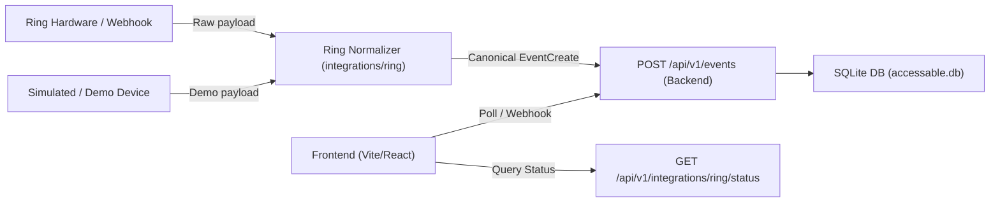

# Ring Integration Guide & Specification

This guide documents the Ring device integration architecture, connection states, data normalization, and verification steps for AccessAble.

---

## 1. Overview & Architecture

AccessAble ingests doorbell rings, motion alerts, and camera events to provide accessible multimodal alerts (visual flashing, audio cues, high contrast).

The integration architecture separates event ingestion into two tiers:
1. **Integration Tier (`integrations/ring/`)**: Probes Ring hardware/APIs and normalizes raw payloads into the canonical schema.
2. **Backend Core (`backend/app/`)**: Provides persistent event storage, duplicate prevention, acknowledgement tracking, user preferences, and client APIs.



---

## 2. Integration Connection States

The backend exposes `GET /api/v1/integrations/ring/status` to reflect verified hardware connectivity:

| State | `is_connected` | Meaning |
|---|---|---|
| `unknown` | `false` | Default baseline. Live Ring credentials/tokens are unconfigured. Demo events are fully functional. |
| `connected` | `true` | Valid session established and upstream stream/polling is verified active. |
| `disconnected` | `false` | Ring service is intentionally paused or network connection was dropped. |
| `error` | `false` | Upstream authentication or connection failure (non-sensitive error returned in `error_message`). |

*Note: The backend never reports `connected` merely because FastAPI is running. True connectivity requires active verification.*

---

## 3. Demo vs. Real Events

To ensure reliable frontend testing and demonstrations during hackathons without needing physical Ring hardware:

| Attribute | Demo Events | Real Ring Events |
|---|---|---|
| `source` | `"demo"` | `"ring"` |
| `external_event_id` | Optional / e.g. `"demo-001"` | Required hardware event ID (e.g. `"ring-evt-789"`) |
| `metadata` | Flexible (e.g. `{"is_simulated": true}`) | Device metadata (e.g. `{"battery": 92, "zone": "porch"}`) |
| Deduplication | Unique per request if ID is null | Deduplicated by `(source, external_event_id)` |

---

## 4. Ingestion Payload Contract

Both demo scripts and the Ring adapter post to `POST /api/v1/events` using this JSON payload:

```json
{
  "source": "ring",
  "external_event_id": "event-12345",
  "event_type": "motion",
  "occurred_at": "2026-10-21T18:00:00Z",
  "device_id": "doorbell-front",
  "metadata": {
    "battery_level": 88
  }
}
```

### Event Normalization
The normalizer in `integrations/ring/app/normalizer.py` ensures:
- `event_type` is trimmed and lowercased (`"motion"`, `"doorbell_press"`).
- `occurred_at` timestamps are parsed and converted to ISO 8601 UTC with explicit timezone indicator (`Z`).
- Sensitive keys (`token`, `secret`, `password`, `api_key`) in `metadata` are blocked.

---

## 5. Local Testing & Verification

### Running Ring Adapter Tests
```powershell
# From the backend directory
pytest app/tests/test_ring_adapter.py
```

### Simulating a Demo Event
```powershell
curl.exe -X POST http://127.0.0.1:8000/api/v1/events `
  -H "Content-Type: application/json" `
  -d '{"source": "demo", "event_type": "doorbell_press", "occurred_at": "2026-10-21T18:30:00Z", "device_id": "demo-btn-1", "metadata": {"chime": true}}'
```

### Querying Integration Status
```powershell
curl.exe http://127.0.0.1:8000/api/v1/integrations/ring/status
```

---

## 6. Live Ring Integration Onboarding

When authorized Ring API credentials or developer tokens become available from hardware testing:
1. Set Ring credentials in `.env` (never commit `.env` to Git).
2. Wire credentials into the client adapter in `integrations/ring/app/ring_client.py`.
3. Update connection state via `RingAdapter` to transition from `unknown` to `connected`.
4. Verify event deduplication using the camera's native `event_id`.
